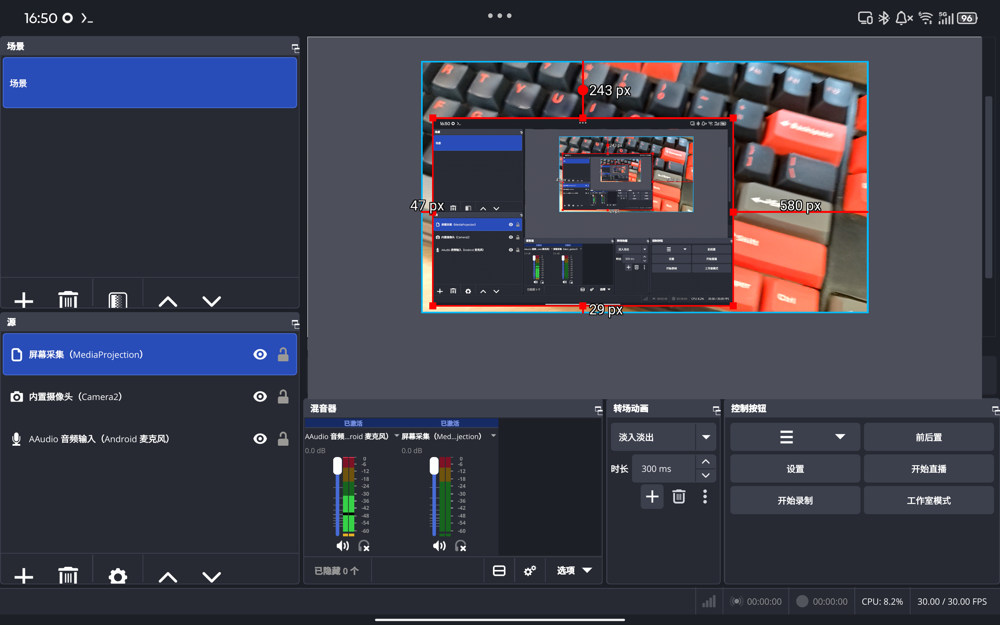
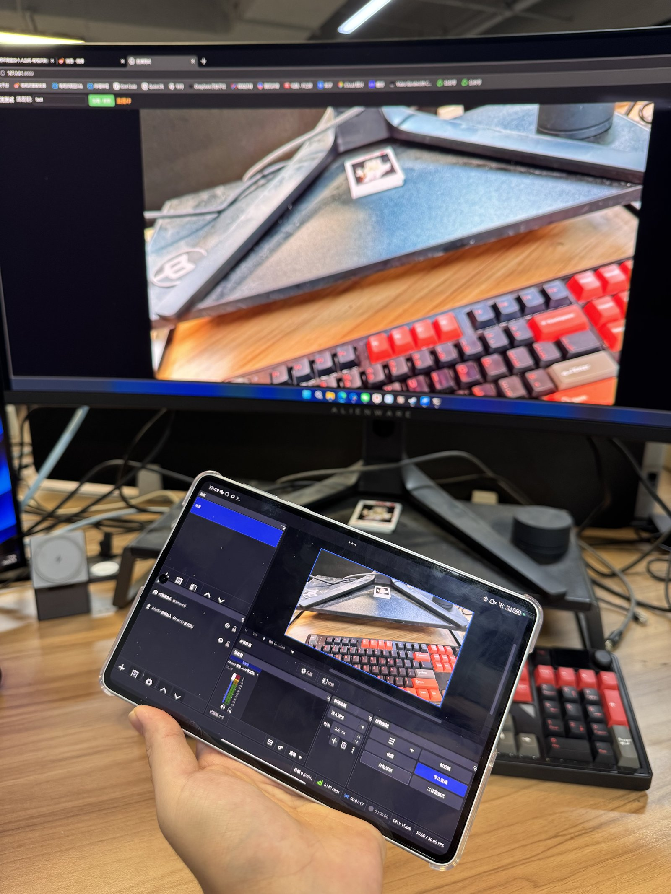

# OBS Studio for Android

**English** | [简体中文](README_CN.md)

A working branch porting [OBS Studio](https://github.com/obsproject/obs-studio) to Android. The current baseline is upstream **32.2.1** (commit `57bfcf10a`), on top of which this repo provides: the `libobs` Android platform layer, a GLES/EGL rendering backend, Android adaptation of the Qt frontend, four `android-*` capture plugins, USB host capture sources (PTP for Nikon Z bodies, UVC for webcams/HDMI capture cards), and the Java host on the APK side.

The goal is **an OBS on Android that can record, stream, and actually be used** — not a demo. All development and verification is done on **WSL2 + a real arm64 device**.



Live RTMP streaming test over LAN — the tablet streams its camera at ~6 Mbps / 30 FPS while the monitor behind plays the received stream:



---

## Status at a glance

| Capability | Status | Notes |
|---|---|---|
| libobs + plugins + Qt frontend built into an APK | ✅ Verified | arm64-v8a, WSL2 build chain |
| Preview, scenes, sources, filter panels | ✅ Verified | Landscape only, laid out for 16:10; sRGB window surface, colors match the system |
| Recording (mp4/mkv, x264 + AAC) | ✅ Verified | Recorded files have valid video/audio tracks |
| Built-in camera source (Camera2 NDK) | ✅ Verified | Tested on a real device, with one-tap front/back switching on the main UI |
| Nikon Webcam source (Z series, self-implemented PTP) | ✅ Verified | Real Z8: 1024×576 @ ~55 fps, 22 min continuous, zero dropped frames |
| UVC camera / HDMI capture card source (self-implemented UVC-over-libusb) | ✅ Verified | UGREEN 95348 (2b89:5348), YUYV 1280×720@60 stable (~56 fps measured) |
| Screen capture source (MediaProjection + VirtualDisplay) | ✅ Verified | Tested on a real device; can recursively capture OBS's own window |
| System audio capture (AudioPlaybackCapture) | ✅ Verified | Reaches the mixer on a real device; recordings have sound |
| Foreground keep-alive service (survives long record/stream sessions) | ✅ Verified | Not reclaimed by the system during long runs on a real device |
| Streaming (RTMP) | ✅ Verified | Live LAN streaming test on a real device (photo below) |

## USB capture sources (OTG)

Both ride the frontend's USB host bus (the Java side opens the device and hands the fd down to libobs) — no root needed.

### Nikon Webcam (Z series)

- Source id `nikon_webcam_input`. Speaks **self-implemented PTP** directly to Nikon Z-series bodies — **no Nikon SDK required** (the official SDK ships for Windows/macOS only).
- Camera side: just set USB to MTP/PTP mode. Verified on a real Z8: **1024×576 @ ~55 fps, 22 minutes continuous, zero dropped frames**.
- Limits: in photo mode Live View is 1024×768 (4:3, untested); while the app holds the camera, other hosts (e.g. a PC) cannot reach it; the Z8 has no UVC mode, so the UVC source below cannot use it directly.

### UVC camera (Android USB)

- Source id `android_video_input`, listed as "UVC 摄像头（Android USB）". **Rewritten from scratch as self-implemented UVC-over-libusb** — libuvc's init is denied by SELinux on Android. Device enumeration, permission, detaching the kernel `uvcvideo` driver, format negotiation, an asynchronous bulk-read pipeline, and error self-healing are all handled in-house.
- Verified: **UGREEN 95348 HDMI capture card (2b89:5348), YUYV 1280×720@60 stable** (~56 fps measured) — works with a camera's HDMI output.
- Quirks & self-healing: a quirks table (2b89:5348's MJPEG/NV12 outputs are a full black field — a firmware defect, also reproducible on Windows — so YUYV is preferred automatically); any card outputting black frames for 3 s is auto-downgraded to YUYV; a freeze watchdog renegotiates a stalled stream; unplug/replug recovers by itself.
- Resolution: the ceiling depends on both the device and the host — YUYV 1080p60 needs a sustained **250 MB/s** (trivial for PCs, but phones/tablets generally can't keep up and the stream freezes). **For 1080p and above, prefer a capture card with a healthy MJPEG path** (MJPEG 1080p60 is only ~10–20 MB/s, mobile-friendly). The source accepts up to the device-reported 4K.
- For Z8 owners: the Z8 has no UVC mode — "Z8 as webcam" goes through an HDMI capture card (this source) or the PTP source above.

## Repository layout

```
OBS_for_Android/
├── obs-studio/          Upstream OBS source + all porting changes (libobs Android platform
│                        layer, GLES/EGL backend, Qt frontend adaptation, android-* capture
│                        plugins, Java host)
├── android-shell/       Minimal Qt Android shell (regression vehicle for early milestones),
│                        contains the standard debug keystore used for signing
├── deps-android/        Download & cross-compile scripts for third-party dependencies
│                        (versions.sh is the single source of truth for versions; the src/
│                        downloads and prebuilt/ outputs are not committed — regenerate them
│                        by running the scripts)
└── scripts/
    └── build-frontend-apk-wsl.sh    One-shot build/sign script for the frontend APK
                                     (WSL, arm64-v8a)
```

Not committed: `releases/` (installable APKs are attached to GitHub Releases), `prebuilt/` (the APK's native payload, a build artifact), `build-fe-*/` (CMake build directories).

The header comments of `obs-studio/frontend/cmake/android/AndroidManifest.xml` record the rationale for every permission and every `screenOrientation` — if you want to understand "why the manifest looks like this", read that first.

## Requirements

Every version below is one actually used — not "should also work":

| Component | Version | Notes |
|---|---|---|
| Host | WSL2 (Ubuntu) | Reaching GitHub requires the host-side proxy (see pitfall #2) |
| Android NDK | **30.0.16138531** | `linux-x86_64` |
| Android SDK | build-tools **36.0.0**, platform **android-35** | Compiled with `ANDROID_PLATFORM=android-29` |
| Qt | **6.9.3**, needs `android_arm64_v8a` + **`gcc_64` (as QT_HOST_PATH, provides androiddeployqt — no package without it)** | |
| CMake | 3.31.6 (installed via pip) | |
| Ninja | 1.13.2 | |
| Gradle | 8.14.5 | |
| JDK | **17** | See pitfall #1 |
| Target device | Android 10 (API 29) or newer, arm64 hardware | Debug over adb wireless debugging (`adb pair` + `adb connect`) |

## Building

### 0. Environment

Toolchain paths come from environment variables (`ANDROID_SDK_ROOT` / `QT_DIR` / `QT_HOST_PATH` / `NDK_ROOT`). The build script checks each one up front and fails loudly if any is missing.

### 1. Third-party dependencies

```bash
cd deps-android
./fetch.sh core        # Download dependency sources (simde/uthash/jansson/x264/ffmpeg/…, see versions.sh)
./build.sh             # Cross-compile into prebuilt/<abi>/
```

`deps-android/versions.sh` is the single source of truth for the dependency list and versions, batched by porting stage: `core` (required by libobs), `usb` (OTG capture), `filters` (filters/text sources), `output` (streaming/recording).

### 2. The frontend APK (libobs + rendering backend + plugins + Qt frontend)

```bash
bash scripts/build-frontend-apk-wsl.sh            # Configure + build + package + sign + verify
bash scripts/build-frontend-apk-wsl.sh configure  # CMake configure only (quick check of CMake changes)
```

The artifact is automatically archived to `releases/OBS-Android-arm64-v8a-wsl-<timestamp>.apk`. To install:

```bash
adb connect <phone-IP>:<port>      # On the phone: Developer options → Wireless debugging
adb install -r releases/OBS-Android-arm64-v8a-wsl-<timestamp>.apk
```

Enabled modules: `android-audio` `android-camera` `android-capture` `android-screen` `image-source` `nikon-source` `obs-encode-sink` `obs-ffmpeg` `obs-filters` `obs-outputs` `obs-transitions` `obs-x264` `rtmp-services` `text-freetype2`. Disabled: scripting, Idian Playground, Restream/Twitch/YouTube API integrations.

### 3. When you only changed one .cpp

Don't wait for a full Gradle/ninja round. Copy the **exact** compile command out of `build.ninja` (including `-Werror` and all `-D`/`-I` flags) and add `-fsyntax-only` to check it on the spot:

```bash
ninja -C build-fe-arm64-v8a-plugins -t commands plugins/android-screen/CMakeFiles/android-screen.dir/screen-capture.c.o
```

## Build/debug pitfalls (all paid for)

1. **Gradle 8.12/8.14 does not support JDK 25** (class file major version 69). `JAVA_HOME` must be pinned to JDK 17.
2. **GitHub is not directly reachable inside WSL** — traffic goes through the host's proxy: the proxy client on the Windows host must enable "Allow LAN connections", and Windows Firewall must allow inbound traffic on that port (the WSL subnet counts as an external network). `fetch.sh` applies the proxy per domain automatically (override with the `OBS_PROXY` environment variable). Note that the host IP may change after a WSL restart — get the current one with `ip route | awk '/default/{print $3}'`.
3. **`androiddeployqt` does not sign in release mode**; the script self-signs with `apksigner`. The `android-shell/debug.keystore` in this repo is the standard Android debug key (alias `androiddebugkey`, password `android`) — for local development only.
4. **Plugin `.so` files must be manually staged into `libs/<abi>/` and Gradle's native intermediates must be wiped**, otherwise freshly built plugins don't make it into the package and you end up testing the previous version — that's what the "force repackage" section of `build-frontend-apk-wsl.sh` does. Always verify against the copy **inside the APK**, never the rundir copy.
5. **OBS's `blog()` does not go to logcat.** Logs live on the device at `/data/user/0/com.obsproject.studio/files/.config/obs-studio/logs/*.txt`. The APK manifest carries `android:debuggable="true"`, so on a non-rooted device `adb exec-out run-as com.obsproject.studio cat ...` is enough — **remember to remove that attribute before any formal release build**.
6. **Artifact identity can only be judged by content** (hashes / `strings` / behavior) — never by file size or mtime.

## Permissions (runtime / manifest)

`INTERNET`, `RECORD_AUDIO`, `CAMERA`, `FOREGROUND_SERVICE`, `FOREGROUND_SERVICE_SPECIAL_USE`, `FOREGROUND_SERVICE_MEDIA_PROJECTION`, `WAKE_LOCK`, `POST_NOTIFICATIONS`, `READ/WRITE_EXTERNAL_STORAGE`; in `uses-feature`, `usb.host`, `camera`, and `camera.any` are all `required=false` (so devices without OTG or without a camera can still install the app).

On first launch, all missing permissions are requested in a single `requestPermissions` dialog. The foreground service type is a combined `specialUse|mediaProjection` — no second service, no second persistent notification; the rationale for choosing `specialUse` is documented in the header comments of `ObsForegroundService.java`.

## License and attribution

- Upstream OBS Studio is **GPL-2.0-or-later**; the full license text is in `obs-studio/COPYING`, and the list of authors and third-party components is in `obs-studio/AUTHORS`. All new code in this port uses the same license.
- The linked **Qt 6.9.3** is dual-licensed LGPLv3 / GPL; the Qt libraries in the APK are dynamically linked as separate `.so` files, satisfying the relinking requirement.
- `deps-android/` fetches and cross-compiles x264, FFmpeg, mbedTLS, curl, FreeType, libjpeg-turbo, speexdsp, rnnoise, libuvc, etc. — each under its own upstream license; check them yourself before distributing build artifacts that contain these binaries.

## Out of scope

No portrait layout — the UI is optimized for landscape only, targeting a 16:10 aspect ratio.
